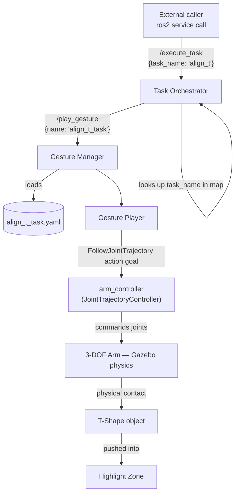
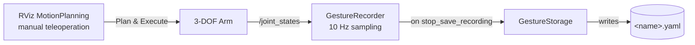

# 3-DOF Robotic Arm — Learning from Demonstration & Task Orchestration

A ROS 2 (Humble) system that teaches a 3-DOF robotic arm to physically manipulate objects through teleoperated demonstration, then replays and orchestrates that skill autonomously inside a Gazebo physics simulation.

The robot is manually guided in RViz to push a **T-shaped object** into a **target zone**. That demonstration is recorded, saved, and can later be triggered on demand through a single high-level service call — `/execute_task`.

---

## Overview

This project extends an existing kinematic "fake-hardware" gesture recorder into a full physics-aware manipulation pipeline, built in three stages:

1. **Physics Integration** — the arm, a pushable T-shaped object, and a visual target zone all live inside a real Gazebo simulation with collisions, mass, and friction.
2. **Learning from Demonstration** — the arm is taught to push the T-shape into the target zone by manually driving it in RViz; the motion is recorded and saved as a replayable gesture.
3. **Task Orchestration** — a high-level node exposes a single `/execute_task` service that maps a task name (e.g. `"align_t"`) to a recorded gesture and executes it end-to-end.

---

## Architecture



**How the demonstration itself is captured:**



The `task_orchestrator` never talks to the arm directly — it only talks to `gesture_interface` over ROS 2 services. This keeps the two packages independently testable and swappable, per the modularity requirement this project was built against.

---

## Project Structure

```
replay_sim/
├── src/
│   ├── simple_moveitmanual/        # Robot description, MoveIt config, Gazebo world
│   │   ├── urdf/
│   │   │   ├── simplearm.urdf          # 3-DOF arm + ros2_control + gazebo_ros2_control plugin
│   │   │   ├── t_shape.urdf             # Pushable object — inertia tensors + collision geometry
│   │   │   └── highlight_zone.sdf       # Visual-only target marker (native SDF, no collision)
│   │   ├── worlds/
│   │   │   └── arm_world.world          # Ground plane, lighting, physics parameters
│   │   ├── launch/
│   │   │   ├── demo.launch.py           # Original RViz + fake-hardware bring-up
│   │   │   └── gazebo.launch.py         # Full Gazebo physics bring-up (robot + objects + MoveIt + RViz)
│   │   ├── config/
│   │   │   └── ros2_controllers.yaml
│   │   └── rviz/
│   │
│   ├── gesture_interface_msgs/     # Custom service definitions
│   │   └── srv/
│   │       ├── StartRecording.srv
│   │       ├── StopSaveRecording.srv
│   │       ├── PlayGesture.srv
│   │       └── ExecuteTask.srv
│   │
│   ├── gesture_interface/          # Recording / storage / playback engine
│   │   ├── gesture_interface/
│   │   │   ├── gesture_manager_node.py  # Owns the three services, coordinates the classes below
│   │   │   ├── gesture_recorder.py      # Subscribes /joint_states, samples at 10 Hz
│   │   │   ├── gesture_player.py        # Sends FollowJointTrajectory goals to arm_controller
│   │   │   └── gesture_storage.py       # YAML save/load
│   │   ├── launch/
│   │   │   └── gesture_interface.launch.py
│   │   └── gestures/
│   │       └── align_t_task.yaml        # The recorded push demonstration
│   │
│   └── task_orchestrator/          # High-level task management (Part 3)
│       ├── task_orchestrator/
│       │   └── task_orchestrator_node.py
│       └── launch/
│           └── task_orchestrator.launch.py
```

---

## Prerequisites

- Ubuntu 22.04
- ROS 2 Humble
- Gazebo Classic 11
- MoveIt 2
- `ros-humble-gazebo-ros2-control`
- `ros-humble-gazebo-ros-pkgs`
- Python 3.10, PyYAML

```bash
sudo apt update
sudo apt install ros-humble-gazebo-ros2-control ros-humble-gazebo-ros-pkgs
```

---

## Build

```bash
cd ~/path/to/replay_sim
colcon build
source install/setup.bash
```

Adding the following to `~/.bashrc` avoids re-sourcing in every new terminal:

```bash
source /opt/ros/humble/setup.bash
source /usr/share/gazebo/setup.bash
source ~/path/to/replay_sim/install/setup.bash
```

---

## Quick Start

Four terminals, run in order.

**Terminal 1 — physics simulation, robot, T-shape, target zone**
```bash
ros2 launch simple_moveitmanual gazebo.launch.py
```

**Terminal 2 — gesture recorder / player**
```bash
ros2 launch gesture_interface gesture_interface.launch.py
```

**Terminal 3 — task orchestrator**
```bash
ros2 launch task_orchestrator task_orchestrator.launch.py
```

**Terminal 4 — trigger the task**
```bash
ros2 service call /execute_task gesture_interface_msgs/srv/ExecuteTask "{task_name: 'align_t'}"
```

Expected result: the arm autonomously replays the recorded push, and the T-shape ends up resting inside the highlight zone.

```
response:
gesture_interface_msgs.srv.ExecuteTask_Response(success=True, message="Task 'align_t' completed via gesture 'align_t_task'")
```

To reset the T-shape to its starting pose between runs:
```bash
ros2 service call /delete_entity gazebo_msgs/srv/DeleteEntity "{name: 't_shape'}"
ros2 run gazebo_ros spawn_entity.py -file <path-to>/t_shape.urdf -entity t_shape -x <x> -y <y> -z 0.0 -Y 0.0
```

---

## How It Works

### Part 1 — Physics Integration & Environment Design
The arm's hardware plugin was switched from `fake_components/GenericSystem` (kinematic-only, no gravity or contact forces) to `gazebo_ros2_control/GazeboSystem`, bridging `ros2_control` into Gazebo's physics engine. `base_link` is fixed to a `world` link via a fixed joint — without this, reaction torque from the arm's own motion causes the whole robot to drift or tip once real physics is active.

The **T-shape** is a two-link URDF (a vertical bar and a horizontal bar joined rigidly) with real solid-box inertia tensors and collision geometry on both links, so the arm's end effector can make genuine contact and push it — not pass through it.

The **highlight zone** is authored directly in **SDF**, not URDF. Gazebo Classic's URDF→SDF conversion pipeline doesn't reliably preserve transparency/emissive material properties, which made an initially-URDF-based zone flicker and disappear; the native SDF version renders consistently. It carries no `<collision>` element at all, so the T-shape can rest inside it freely.

### Part 2 — Learning from Demonstration
With the physics environment stable, the arm is manually driven in RViz's MotionPlanning panel (Plan & Execute) to approach, contact, and push the T-shape toward the highlight zone. `GestureRecorder` subscribes to `/joint_states` and samples at 10 Hz for the whole session; `GestureStorage` writes the captured trajectory to `align_t_task.yaml`. On replay, `GesturePlayer` sends that trajectory as a single `FollowJointTrajectory` action goal to `arm_controller`, which interpolates and executes it under real contact dynamics.

### Part 3 — Task Orchestrator
`task_orchestrator` is a separate package with no dependency on `gesture_interface`'s internals — it only calls `/play_gesture` as a client. It exposes `/execute_task`, which:
1. Looks up the requested `task_name` in an internal `{task_name: gesture_name}` map.
2. Returns a clear error immediately if the task name is unknown, without touching the robot.
3. Calls `/play_gesture` with the mapped gesture name and waits for the result.
4. Returns `success` / `message`, propagating the real outcome from `arm_controller` rather than just "the service call didn't error."

---

## Service Reference

| Service | Package | Request | Response | Description |
|---|---|---|---|---|
| `/start_recording` | `gesture_interface_msgs` | *(empty)* | `success`, `message` | Begins sampling `/joint_states` at 10 Hz |
| `/stop_save_recording` | `gesture_interface_msgs` | `name` | `success`, `message` | Stops recording, saves `<name>.yaml` |
| `/play_gesture` | `gesture_interface_msgs` | `name` | `success`, `message` | Loads and replays a saved gesture |
| `/execute_task` | `gesture_interface_msgs` | `task_name` | `success`, `message` | High-level entry point — maps a task to a gesture and runs it |

---

## Recording a New Gesture

```bash
ros2 service call /start_recording gesture_interface_msgs/srv/StartRecording "{}"
# ... drive the arm in RViz via Plan & Execute ...
ros2 service call /stop_save_recording gesture_interface_msgs/srv/StopSaveRecording "{name: 'my_gesture'}"
```

**One thing to know:** the recorder samples continuously from start to stop, including any real-world time spent pausing between moves. A recording session that takes several minutes of wall-clock time will produce a trajectory that takes just as long to *replay*, because `JointTrajectoryController` paces execution against each point's recorded timestamp. If that happens, don't uniformly rescale the timestamps — that speeds up the actual motion segments too and can change the contact dynamics of the push. Instead, strip out only the genuinely idle stretches (consecutive samples with near-identical joint positions) and cap any remaining pause to a short fixed duration, leaving every real movement at its original recorded speed.

To add a new task once a gesture is recorded, add one line to the `task_map` dictionary in `task_orchestrator_node.py`:
```python
self.task_map = {
    'align_t': 'align_t_task',
    'my_task': 'my_gesture',
}
```

---

## Technical Notes

A few non-obvious issues came up building this that are worth knowing if you extend the project:

- **Action calls from inside a service callback can deadlock.** Calling `send_goal_async` / `spin_until_future_complete` directly from within a service callback running on the same executor as the action client can hang indefinitely — the executor is busy waiting on the callback, so it can never deliver the action's own result callback. `GesturePlayer` works around this by giving its `ActionClient` a fully separate `rclpy` node with its own dedicated executor thread, and dispatching the goal via a one-shot timer so `send_goal_async` is called from within that isolated executor's own thread context.
- **`GestureManager` and `TaskOrchestrator` both run a `MultiThreadedExecutor` with `ReentrantCallbackGroup`** on their services, so a long-running playback doesn't block other incoming service calls.
- **Success is verified against the controller's actual result**, not just "the RPC returned." `GesturePlayer` checks both the goal's `GoalStatus` and `FollowJointTrajectory.Result.error_code` before reporting success up the chain.

---

## Known Limitations / Future Work

- Gazebo Classic reaches end-of-life in January 2025; migrating to Gazebo Sim (Ignition) via `ros_gz` would be the natural next step.
- The task-name → gesture-name map in `task_orchestrator_node.py` is currently hardcoded; making it parameter- or YAML-driven would let tasks be added without a rebuild.
- The 70% T-shape/zone overlap requirement is currently verified visually rather than programmatically; a pose-comparison check (querying both models' poses via Gazebo services and computing footprint overlap) could be added to `task_orchestrator` to make success verification fully autonomous.

---

## License

Apache-2.0, matching the existing `gesture_interface` and `gesture_interface_msgs` packages.