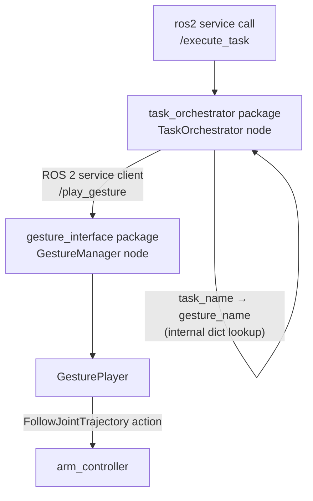

# Task Log

## 1. Physics Parameters

### T-Shape Object (`t_shape.urdf`)

The T-shape is modeled as two rigid boxes (`vertical_bar`, `horizontal_bar`) joined by a fixed joint, each with explicit inertia tensors computed from the standard solid-box formula rather than left at a placeholder — this is what prevents the jittering Gazebo produces when `<inertia>` values don't match the actual geometry:

```
Ixx = (1/12) · m · (h² + d²)
Iyy = (1/12) · m · (w² + d²)
Izz = (1/12) · m · (w² + h²)
```

| Link | mass | size (w × d × h, m) | Ixx | Iyy | Izz |
|---|---|---|---|---|---|
| `vertical_bar` | 0.2 kg | 0.06 × 0.06 × 0.25 | 0.001102 | 0.000120 | 0.001102 |
| `horizontal_bar` | 0.1 kg | 0.20 × 0.06 × 0.06 | 0.000060 | 0.000363 | 0.000363 |

**Friction:** `mu1 = mu2 = 0.3` on both links. Higher values (tested up to 0.8) resisted sliding enough that contact from the arm's rod produced a tipping torque instead of a clean push; lower values (tested down to 0.05) made the object slide unpredictably on the slightest touch. 0.3 was the value at which the object could be reliably pushed without either sticking in place or sliding away uncontrollably.

**Contact stiffness/damping:** `kp = 1000000.0`, `kd = 1.0`. `kp` this high keeps the object from sinking into the ground plane on contact; `kd` absorbs impact energy so the object doesn't visibly bounce or jitter the instant the arm touches it.

**Collision geometry** is present on both links (not visual-only), which is what allows the arm's end rod to physically displace the object rather than pass through it.

### Highlight Zone (`highlight_zone.sdf`)

Authored directly in native SDF rather than URDF. Gazebo Classic's URDF→SDF conversion does not reliably preserve transparency/emissive material properties — an initial URDF-based version of this zone rendered inconsistently and would intermittently disappear. The SDF version uses an `<emissive>` material value, which renders reliably regardless of scene lighting.

It intentionally has **no `<collision>` element on either of its two links** — this is what allows the T-shape to rest inside it with zero physical interaction, satisfying the "visual-only marker" requirement. It is marked `<static>true</static>` since it never needs to move.

### Arm — Gravity & Trajectory Following

Two changes were required to move the arm from the original fake-hardware setup to one that holds its own weight and follows trajectories under real physics:

1. **`base_link` is fixed to a `world` link** via an explicit fixed joint. Without this, the arm's own reaction torque during motion — which is only physically simulated once real physics is active — caused the entire robot to drift or tip, since nothing was anchoring it to the ground.
2. **PID gains declared per-joint inside the `<ros2_control>` block** (`p`, `d`, `i`, `i_clamp`), read directly by the `gazebo_ros2_control/GazeboSystem` hardware interface. These provide the holding force needed to keep the arm upright against gravity and to track commanded trajectory positions under load — without them the arm sags or falls immediately after spawning.

---

## 2. Task Orchestrator ↔ Gesture Manager Architecture



**The two packages are fully independent.** `task_orchestrator` has no build or import dependency on `gesture_interface`'s internal classes (`GestureRecorder`, `GesturePlayer`, `GestureStorage`) — its only coupling is the `gesture_interface_msgs/srv/PlayGesture` service interface, called as an ordinary ROS 2 client. Either package can be modified, rebuilt, or replaced independently as long as that service contract is preserved. This satisfies the modularity requirement directly.

**Task mapping** lives entirely inside `TaskOrchestrator` as an in-memory dictionary:
```python
self.task_map = {
    'align_t': 'align_t_task',
}
```
`GestureManager` has no concept of "tasks" at all — it only knows about named gesture files. All task-level semantics belong to the orchestrator, which is what makes it possible to add new tasks (`'push_x': 'push_x_task'`, etc.) without touching `gesture_interface`.

**Error handling** happens at two independent points:
- If `task_name` isn't in the map, `TaskOrchestrator` returns `success=False` with a descriptive message immediately — `GestureManager` is never contacted.
- If `/play_gesture` reports failure (gesture file not found, or the trajectory result wasn't successful), that failure message is propagated back through `TaskOrchestrator`'s response rather than being swallowed.

**Execution model:** both `GestureManager` and `TaskOrchestrator` run under a `MultiThreadedExecutor` with `ReentrantCallbackGroup` on their services, so a long-running playback doesn't block other incoming calls. `GesturePlayer`'s action client to `arm_controller` runs on a fully separate `rclpy` node with its own isolated executor thread — calling `send_goal_async` from the same executor thread as the blocking service callback that invoked it causes a deadlock, since that executor thread can never become free to deliver the action's own result callback. Dispatching the goal via a one-shot timer inside the isolated node's executor avoids this. Success is verified against the controller's actual `GoalStatus` and `FollowJointTrajectory.Result.error_code`, not just "the service call returned without an exception."

---

## 3. Launch Instructions

### Prerequisites
```bash
sudo apt install ros-humble-gazebo-ros2-control ros-humble-gazebo-ros-pkgs
```

### Build
```bash
cd <workspace_root>
colcon build
source install/setup.bash
```

### Run — four terminals, in order

**Terminal 1 — Gazebo physics, robot, T-shape, highlight zone**
```bash
ros2 launch simple_moveitmanual gazebo.launch.py
```

**Terminal 2 — gesture recorder / player**
```bash
ros2 launch gesture_interface gesture_interface.launch.py
```

**Terminal 3 — task orchestrator**
```bash
ros2 launch task_orchestrator task_orchestrator.launch.py
```

**Terminal 4 — trigger the "Align T" task**
```bash
ros2 service call /execute_task gesture_interface_msgs/srv/ExecuteTask "{task_name: 'align_t'}"
```

Expected response:
```
response:
gesture_interface_msgs.srv.ExecuteTask_Response(success=True, message="Task 'align_t' completed via gesture 'align_t_task'")
```

### Resetting between runs

The T-shape does not reset itself after a push. To re-run the demonstration from its starting pose:
```bash
ros2 service call /delete_entity gazebo_msgs/srv/DeleteEntity "{name: 't_shape'}"
ros2 run gazebo_ros spawn_entity.py -file <path-to>/t_shape.urdf -entity t_shape -x 0.20 -y 0.0 -z 0.0 -Y 0.0


Also if we want to know goal reached we can check from this command after ctrl+c my terminal 1
grep -h "Goal reached" ~/.ros/log/*/launch.log 2>/dev/null | tail -3
```